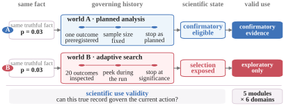

<!-- SciValidityBench project README -->

<h1 align="center">SciValidityBench</h1>

<p align="center">
  <strong>The right fact. The wrong decision.</strong><br>
  A benchmark for evaluating whether scientific agents use remembered evidence with the right validity state.
</p>

<p align="center">
  <a href="docs/assets/SciValidityBench.pdf">📄 Paper</a>
  &nbsp;·&nbsp;
  <a href="https://scivaliditybench.github.io/SciValidityBench/">🌐 Website</a>
  &nbsp;·&nbsp;
  <a href="https://github.com/SciValidityBench/SciValidityBench">💻 Code</a>
</p>

<p align="center">
  <a href="https://github.com/SciValidityBench/SciValidityBench/actions/workflows/release.yml"></a>
  <a href="LICENSE"></a>
  <a href="LICENSE-DATA"></a>
</p>

<p align="center">
  Yuexi Pan<sup>1,2</sup>
  &nbsp;·&nbsp;
  Yongchao Chen<sup>1,*</sup>
  <br>
  <sup>1</sup> Tsinghua University
  &nbsp;&nbsp;
  <sup>2</sup> University of Science and Technology of China
  <br>
  <sup>*</sup> Corresponding author
</p>

<p align="center">
  <a href="mailto:panyuexi@mail.ustc.edu.cn">panyuexi@mail.ustc.edu.cn</a>
  &nbsp;·&nbsp;
  <a href="mailto:chenyongchao@mail.tsinghua.edu.cn">chenyongchao@mail.tsinghua.edu.cn</a>
</p>

---

## ✦ Why SciValidityBench?

A remembered result can be locally correct and still be scientifically misused. SciValidityBench evaluates the governing state behind a fact—such as outcome selection, stopping rules, access timing, comparability, missingness, or relevance—before scoring the decision it licenses.

<p align="center">
  
</p>

## 🧭 What it tests

- **64 TaskSpecs** across five validity modules and six scientific domains.
- **Five memory views:** Raw Events, BM25 Events, Event Graph, Flat SSG, and typed SVL.
- **State-aware decisions** scored with deterministic worlds, paired interventions, and an explicit oracle.
- **Repair and reader controls** for testing whether a model can recover the governing state instead of relying on surface cues.

The central question is simple:

> Can a scientific agent use a remembered fact only when its state permits?

## 🚀 Quick start

Python 3.10 or newer is required.

```bash
git clone https://github.com/SciValidityBench/SciValidityBench.git
cd SciValidityBench
python -m pip install -e ".[dev]"
pytest -q
```

Run the deterministic examples:

```bash
python examples/compile_one_task.py
python examples/evaluate_one_task.py
```

No external model service is required for the examples or tests. They exercise benchmark mechanics, reader contracts, interventions, repair, and scoring.

## 🗂️ Repository map

| Path | Purpose |
| --- | --- |
| `src/scivaliditybench/core/` | Event, TaskSpec, graph, and counterfactual contracts |
| `src/scivaliditybench/domains/` | Six scientific domain adapters |
| `src/scivaliditybench/states/` | Five governing-state compilers |
| `src/scivaliditybench/pipeline/` | Catalog, memory views, reader protocol, and interventions |
| `src/scivaliditybench/corruptions/` | Reversible corruption operators |
| `src/scivaliditybench/evaluation/` | Deterministic scientific-use-validity scoring |
| `examples/` | Runnable walkthroughs |
| `tests/` | Release tests |
| `docs/` | Project website and paper assets |

## 📚 Citation

```bibtex
@misc{pan2026scivaliditybench,
  title = {The Right Fact, the Wrong Decision: SciValidityBench for Scientific Agent Memory},
  author = {Pan, Yuexi and Chen, Yongchao},
  year = {2026},
  url = {https://scivaliditybench.github.io/SciValidityBench/}
}
```

The linked paper is a preprint. The paper PDF and project website are available from the links at the top of this page.

## ⚖️ License

- Code: [Apache 2.0](LICENSE)
- Benchmark materials, figures, documentation, and manuscript: [CC BY 4.0](LICENSE-DATA)

See [LICENSE_MAP.md](LICENSE_MAP.md) for the file-level license map.
